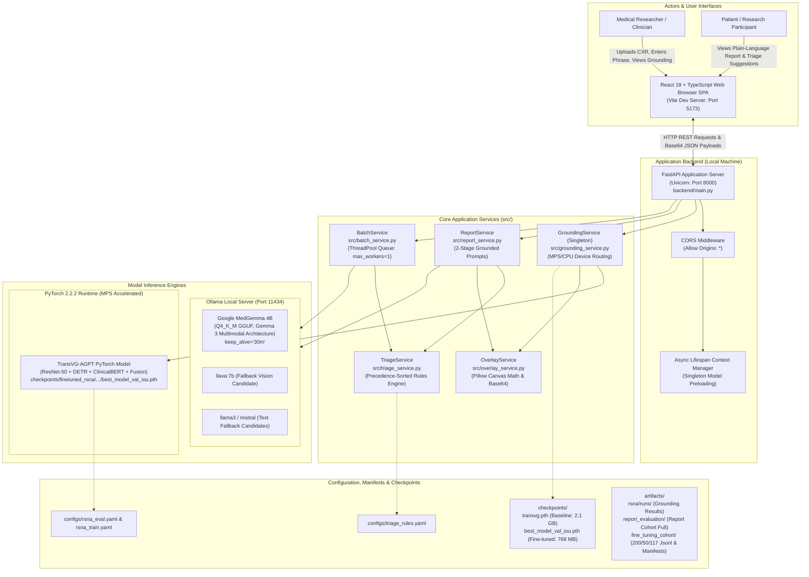

# InteractMed-VLM: System Architecture & Technical Specification

> **Authoritative System Architecture Reference**  
> **Project:** InteractMed-VLM — Vision-Language System for Chest X-Ray Grounding, Report Generation, Patient-Friendly Explanation, Batch Processing, and Research-Only Triage  
> **Repository Version:** 2.0.0 (API) / Production Active  
> **Date:** October 2026  
> **Status:** Fully Audited against Active Codebase, Checkpoints, Manifests, and Test Suites (104/104 Passing Tests)

---

## 1. System Overview & Scope

### 1.1 Purpose & Problem Statement
Chest radiography (CXR) is the most frequently performed medical imaging procedure globally, yet interpreting radiographs presents two fundamental challenges:
1. **Localization vs. Synthesis Divergence:** Clinicians frequently need to query whether a specific localized radiographic finding (e.g., pneumonia, pleural effusion, pneumothorax) is present at a specific anatomical site (**visual grounding**), while simultaneously requiring an overarching, comprehensive synthesis of all visible cardiopulmonary structures across the entire thoracic radiograph (**report generation**).
2. **Communication & Triage Gaps:** Radiology reports are dense with technical jargon that confuses patients seeking to understand their imaging. Meanwhile, research workflows require preliminary, transparent triage sorting to highlight cases with potentially urgent findings for expedited human review without relying on opaque, unvalidated end-to-end black-box classifiers.

**InteractMed-VLM** addresses these challenges through a modular, multimodal AI architecture that unifies five distinct clinical AI capabilities within a single, cohesive research workstation, while strictly separating their computational tasks.

---

### 1.2 The Five Core Capabilities & Separation of Concerns

It is a core architectural rule of InteractMed-VLM that **image grounding and report generation are distinct computational tasks and must never be conflated**:

```
                               ┌──────────────────────────────────────────────────────────┐
                               │                 Input Chest Radiograph                   │
                               │                (DICOM, PNG, JPEG, TIFF)                  │
                               └────────────────────────────┬─────────────────────────────┘
                                                            │
                     ┌──────────────────────────────────────┴──────────────────────────────────────┐
                     ▼                                                                             ▼
       ┌───────────────────────────┐                                                 ┌───────────────────────────┐
       │     Phrase Grounding      │                                                 │    Full-Image Analysis    │
       │  "Where is finding X?"    │                                                 │   "What is on this CXR?"  │
       └─────────────┬─────────────┘                                                 └─────────────┬─────────────┘
                     │                                                                             │
                     ▼                                                                             ▼
        TransVG-AGPT Transformer                                                      Google MedGemma 4B VLM
    Conditioned on Clinical Phrase                                                   Prompt v3 Structured Pipeline
                     │                                                                             │
                     ▼                                                               ┌─────────────┴─────────────┐
        Predicted Bounding Box                                                       ▼                           ▼
        Pixel / Canvas Coordinates                                          Radiologist Draft            Patient-Friendly
        Overlay + Region Crop                                               Structured Sections             Explanation
                                                                                     │
                                                                                     ▼
                                                                            Deterministic Triage
                                                                            Rule Engine (YAML)
                                                                            Provisional Urgency
```

1. **Phrase-Conditioned Visual Grounding:**
   - **Task:** Answering *"Where is finding $X$ located on this radiograph?"*
   - **Model:** TransVG-AGPT (ResNet-50 + DETR Visual Transformer + ClinicalBERT + Multimodal Fusion Transformer).
   - **Input:** Full radiograph + specific clinical query phrase (e.g., `"pneumonia"`).
   - **Output:** Normalized coordinates `[cx, cy, w, h]`, absolute pixel coordinates `[x1, y1, x2, y2]`, visual overlay rendering, and extracted high-resolution region crop.
   - **Scope:** Localizes user-requested pathology; does **not** interpret the whole image or diagnose unqueried conditions.

2. **Full-Image Structured Report Generation:**
   - **Task:** Answering *"What are the overall radiographic observations, impressions, and technical limitations across the entire thoracic image?"*
   - **Model:** Google MedGemma 4B (`medgemma:4b` served locally via Ollama with Metal GPU acceleration).
   - **Input:** Complete thoracic radiograph (standardized to 1024 px max side).
   - **Output:** Structured 4-section report (`OBSERVATIONS`, `POSSIBLE FINDINGS`, `ASSESSMENT AND UNCERTAINTY`, `LIMITATIONS`) using a 2-stage grounded prompt pipeline.
   - **Scope:** Interprets global image; does **not** rely on TransVG bounding box crops for whole-image synthesis.

3. **Patient-Friendly Plain-Language Explanation:**
   - **Task:** Translating complex imaging features into calm, 6th-grade reading-level explanations for patient understanding.
   - **Architecture:** Two-stage grounded translation: Stage 1 extracts objective visual features; Stage 2 translates them under 4 strict headings (`Your X-ray in simple words`, `What the findings may mean`, `What is uncertain`, `What happens next`).
   - **Safety Layer:** Deterministic factual sanitizer eliminates common VLM anatomical misconceptions (e.g., correcting hallucinations that a frontal view only depicts one side of the chest).

4. **Sequential Batch Processing (Up to 10 Radiographs):**
   - **Task:** High-throughput, automated report drafting across multiple independent radiographs.
   - **Engine:** Bounded single-worker ThreadPool queue (`max_workers=1`) designed for Apple Silicon unified memory safety, featuring live progress streaming, per-job telemetry, granular failure isolation, job retry, and CSV/JSON export.

5. **Research-Only Triage Urgency Categorization:**
   - **Task:** Heuristic prioritization of radiographs based on structured radiological observations.
   - **Engine:** Decoupled, deterministic rule engine (`src/triage_service.py`, `configs/triage_rules.yaml`) with explicit regex-based negation and internal contradiction filtering.
   - **Output:** Four provisional research categories: `potentially_urgent`, `abnormality_flagged`, `no_priority_finding_flagged`, and `indeterminate_review_required`.
   - **Clinical Governance:** Prototype heuristic tool for research triage queue simulation; **not** a diagnostic device and not cleared for clinical patient management.

---

## 2. High-Level System Architecture

### 2.1 System Context Diagram
The following Mermaid diagram illustrates the system boundaries, users, local execution runtimes, and storage layers:



---

## 3. Component Architecture & Responsibility Matrix

### 3.1 Component Responsibility Table
Every core component in the repository has a defined single responsibility, explicit input/output contract, failure handling mode, and associated test coverage:

| Component Name | File Path | Core Responsibility | Inputs | Outputs | Models / Dependencies Called | Error Handling Behavior | Associated Tests | Implementation Status |
| :--- | :--- | :--- | :--- | :--- | :--- | :--- | :--- | :--- |
| **API Server Gateway** | [`backend/main.py`](file:///Users/adityakachhot/interactmed/backend/main.py) | REST API routing, upload validation, CORS, lifespan startup preloading | HTTP Multi-part Form Data (`file`, `query`, `style`) | Pydantic JSON responses (`GroundingResponse`, `BatchStatusResponse`, etc.) | FastAPI, Pydantic, Uvicorn, all `src/` services | Returns HTTP 400 (bad params), 413 (>50MB), 415 (invalid format), 503 (model unready) | [`tests/test_backend_api.py`](file:///Users/adityakachhot/interactmed/tests/test_backend_api.py) | **IMPLEMENTED & TESTED** |
| **Grounding Service** | [`src/grounding_service.py`](file:///Users/adityakachhot/interactmed/src/grounding_service.py) | Singleton wrapper for TransVG-AGPT; image letterboxing, coordinate transformation | Raw image bytes (`.dcm`, `.png`, `.jpg`), query phrase string, checkpoint selection | Dict: `pred_box_norm`, `pred_box_pixel`, `pred_box_canvas`, `latency_ms`, `success` | TransVG-AGPT (`third_party/AGPT`), PyTorch (MPS/CPU), ClinicalBERT tokenizer | Catches PyTorch exceptions, returns `success: false` with descriptive error string | [`tests/test_grounding_inference.py`](file:///Users/adityakachhot/interactmed/tests/test_grounding_inference.py) | **IMPLEMENTED, TESTED & EVALUATED** |
| **Overlay Renderer** | [`src/overlay_service.py`](file:///Users/adityakachhot/interactmed/src/overlay_service.py) | Draws bounding boxes, query text labels, and crops on radiograph canvas | Image bytes/array, pixel box `[x1,y1,x2,y2]`, query label | PIL Image annotated, Base64 encoded JPEG | PIL (Pillow), NumPy | Clamps coordinates to `[0, W]` and `[0, H]`; returns unannotated image on fault | [`tests/test_coordinate_conversion.py`](file:///Users/adityakachhot/interactmed/tests/test_coordinate_conversion.py) | **IMPLEMENTED & TESTED** |
| **Report Service** | [`src/report_service.py`](file:///Users/adityakachhot/interactmed/src/report_service.py) | Two-stage grounded report synthesis (Patient & Region modes); anatomical sanitizer | Full image bytes, clinical indication, history, crop box | Dict: `report_text`, `sections`, `triage_result`, `timing`, `validation_warnings` | Ollama HTTP API (`medgemma:4b`), `TriageService` | Fallback to cautious indeterminate report; flags ungrounded assertions | [`tests/test_report_generator.py`](file:///Users/adityakachhot/interactmed/tests/test_report_generator.py) | **IMPLEMENTED, TESTED & EVALUATED** |
| **Batch Service** | [`src/batch_service.py`](file:///Users/adityakachhot/interactmed/src/batch_service.py) | Bounded sequential batch execution (up to 10 images); retry, cancellation, export | List of `(filename, bytes)` tuples, report style | `BatchJob` dataclass, CSV string, JSON string | Ollama HTTP API (`medgemma:4b`), `TriageService`, `ThreadPoolExecutor` | Per-item failure isolation (item status: `failed`), preserving other batch items | [`tests/test_batch_service.py`](file:///Users/adityakachhot/interactmed/tests/test_batch_service.py) | **IMPLEMENTED & TESTED** |
| **Triage Service** | [`src/triage_service.py`](file:///Users/adityakachhot/interactmed/src/triage_service.py) | Decoupled rule-based priority categorization with negation & contradiction checks | Structured report findings dict or free-text narrative | `TriageEvaluationResult` dataclass (`category`, `rule_id`, `reason`, `disclaimer`) | PyYAML, regex negation engine | Safeguards against errors: invalid image or model error returns `indeterminate_review_required` | [`tests/test_triage_service.py`](file:///Users/adityakachhot/interactmed/tests/test_triage_service.py) | **IMPLEMENTED & TESTED** |
| **RSNA Evaluator** | [`scripts/evaluate_rsna.py`](file:///Users/adityakachhot/interactmed/scripts/evaluate_rsna.py) | Evaluates TransVG-AGPT on RSNA Pneumonia validation & test splits | Split CSV, DICOM directory, checkpoint path, config YAML | CSV predictions, summary JSON, metric comparison charts | TransVG-AGPT, PyTorch, PyDICOM, Albumentations | Skips unreadable files with warning; produces exact confusion and IoU tallies | None (Standalone research CLI) | **IMPLEMENTED & EVALUATED** |
| **MedGemma Trainer** | [`scripts/train_medgemma_lora.py`](file:///Users/adityakachhot/interactmed/scripts/train_medgemma_lora.py) | Preflight checks and 4-bit QLoRA trainer for `google/medgemma-4b-it` | JSONL datasets (`train_dev.jsonl`, `val_dev.jsonl`), YAML config | Saved PEFT LoRA adapter weights, TensorBoard loss logs | Hugging Face Transformers $\ge 4.50$, PEFT, BitsAndBytes, PyTorch (CUDA) | Validates inspect-only, dry-run forward/backward, and single-batch overfit before launch | None (Preflight CLI) | **PREPARED (Preflight Passed; Full Run Standby)** |
| **Frontend Web SPA** | [`frontend/src/App.tsx`](file:///Users/adityakachhot/interactmed/frontend/src/App.tsx) | Interactive user interface: Phrase Grounding, Report Generation, Batch, Metrics | User clicks, file drag-and-drop, query inputs | Rendered HTML5 canvas, SVG bounding boxes, report cards | React 18, TypeScript, Vite, Vanilla CSS design system | Displays user-friendly error banners and latency breakdowns on network/API failure | TypeScript compiler (`tsc`) | **IMPLEMENTED & TESTED** |

---

### 3.2 Legacy / v0.1.0 Stubs vs. Production v2.0.0 Services
During repository inspection, an architectural distinction was uncovered between the initial v0.1.0 prototype stubs and the active production v2.0.0 pipeline:

```
┌────────────────────────────────────────────────────────┐
│                   REPOSITORY ROOTS                     │
├────────────────────────────┬───────────────────────────┤
│    Legacy v0.1.0 Stubs     │     Active v2.0.0 Core    │
│    (Historical / Unit)     │        (Production)       │
├────────────────────────────┼───────────────────────────┤
│ src/region_grounding/      │ src/grounding_service.py  │
│ src/report_generator/      │ src/report_service.py     │
│ src/triage/                │ src/batch_service.py      │
│ src/vision_encoder/        │ src/triage_service.py     │
│ src/explainability/        │ src/overlay_service.py    │
│ src/interface/app.py       │ backend/main.py           │
│ configs/model_config.yaml  │ configs/triage_rules.yaml │
│                            │ configs/rsna_*.yaml       │
└────────────────────────────┴───────────────────────────┘
```

- **Legacy Stubs:** The modules in `src/region_grounding/`, `src/report_generator/`, `src/triage/`, `src/vision_encoder/`, and `src/interface/app.py` represent early v0.1.0 architectural skeletons. They utilize synthetic anatomical priors (fixed rectangular regions for "heart", "lungs", "pleura") and mock report text. While they are retained to maintain backward compatibility with early unit tests in `tests/test_interface.py` and `tests/test_triage.py`, **they are not used in active inference**.
- **Production Pipeline:** The active production path runs through `backend/main.py`, invoking `src/grounding_service.py` (real TransVG-AGPT model weights), `src/report_service.py` (real local MedGemma 4B VLM), `src/batch_service.py` (real batch queue), and `src/triage_service.py` (real configurable rules engine).

---

## 4. Deployment & Runtime Architecture

### 4.1 Local Inference Deployment (Current Verified Setup)
The existing production system is designed to execute locally on an Apple Silicon host (such as an Apple M3 MacBook Air with 16 GB Unified Memory), guaranteeing **complete data privacy** with zero medical data transmission across public networks:

```
┌───────────────────────────────────────────────────────────────────────────────────┐
│                     APPLE SILICON WORKSTATION (macOS / M3 / 16 GB)                 │
│                                                                                   │
│  ┌───────────────────────┐         HTTP          ┌─────────────────────────────┐  │
│  │   Vite Dev Server     │ ────────────────────► │     FastAPI Backend         │  │
│  │   localhost:5173      │ ◄──────────────────── │     localhost:8000          │  │
│  │   (Node 18+, React)   │      REST / JSON      │     (Python 3.10 / uvicorn) │  │
│  └───────────────────────┘                       └──────────────┬──────────────┘  │
│                                                                 │                 │
│                                    ┌────────────────────────────┴───────────┐     │
│                                    │                                        │     │
│                                    ▼ (In-Process C Extension)               ▼     │
│                     ┌─────────────────────────────┐           ┌─────────────────┐ │
│                     │   PyTorch 2.2.2 (Metal MPS) │           │  Ollama Server  │ │
│                     │   TransVG-AGPT Model        │           │  localhost:11434│ │
│                     │   RAM: ~5.2 GB Unified Mem  │           │  medgemma:4b    │ │
│                     └─────────────────────────────┘           │  RAM: ~4.8 GB   │ │
│                                                               └─────────────────┘ │
└───────────────────────────────────────────────────────────────────────────────────┘
```

#### Network Interfaces & Ports
- **Frontend SPA:** `http://localhost:5173` (Vite local development server).
- **Backend API:** `http://localhost:8000` (FastAPI / Uvicorn server).
- **Ollama Engine:** `http://localhost:11434` (Ollama local model server daemon).

#### Unified Memory Budget (16 GB Host)
- **TransVG-AGPT (MPS Device):** ~5.0 – 5.5 GB resident unified memory when loaded.
- **MedGemma 4B (`Q4_K_M` GGUF):** ~4.5 – 5.0 GB resident unified memory under `keep_alive="30m"`.
- **FastAPI Backend & OS Overhead:** ~2.0 – 3.0 GB.
- **Total Footprint:** ~12.5 GB peak unified memory, operating safely within a 16 GB envelope without triggering memory compression or disk swap thrashing.

---

### 4.2 Cloud Training Environment (Proposed for Fine-Tuning)
In contrast to local inference, model fine-tuning (specifically 4-bit QLoRA on MedGemma 4B) cannot run on Apple MPS due to hardware dependencies:
- **CUDA Requirement:** `bitsandbytes` 4-bit NF4 quantization requires compiled NVIDIA CUDA kernels supporting `bfloat16`.
- **Target Cloud Profile:** Google Cloud Platform (GCP) or Google Colab Enterprise with an NVIDIA A100 GPU (40 GB or 80 GB VRAM).
- **Automation Guardrail:** Training scripts are equipped with safety checks (`--inspect-only`, `--dry-run`, `--overfit-single-batch`) and must **never** launch automatically without human engineering authorization.

---

### 4.3 Environment Variables & Configuration Files

| Variable / File | Location / Scope | Purpose & Constraints |
| :--- | :--- | :--- |
| `VITE_API_URL` | Frontend (`frontend/.env` or runtime) | Points frontend to the backend REST endpoint (Default: `http://localhost:8000`). |
| `OLLAMA_BASE_URL` | Backend (`src/report_service.py:43`) | Base URL for Ollama daemon communication (Default: `http://localhost:11434`). |
| `configs/triage_rules.yaml` | Backend filesystem | Declarative precedence rules, regex patterns, and disclaimers for triage categorization. |
| `configs/rsna_eval.yaml` | Backend filesystem | Data paths, image dimensions (640 px), and query freeze parameters for TransVG evaluation. |
| `configs/medgemma_finetune.yaml`| Training filesystem | Hyperparameters, LoRA ranks ($r=16, \alpha=16$), learning rate ($10^{-4}$), and target module mappings. |

---

### 4.4 Privacy, Security & De-Identification Safeguards
1. **Zero External API Leakage:** Medical images, patient attributes, bounding box crops, and drafted reports are strictly evaluated on local loopback sockets (`localhost`). No image tensors or text strings are sent to public commercial APIs (e.g., OpenAI, Anthropic, or external Google Cloud endpoints).
2. **De-Identification Protocol:** No protected health information (PHI), Medical Record Numbers (MRNs), patient names, or hospital site identifiers exist in the repository's evaluation manifests. All evaluation records use anonymized hash strings (e.g., `0004cfab-14fd4621-76a5da31-b061fc81-124e1fc1`).
3. **Log Sanitization:** `src/report_service.py` explicitly attaches a `NullHandler()` and configures logging to avoid logging full report text or base64 image strings at `INFO` level.
