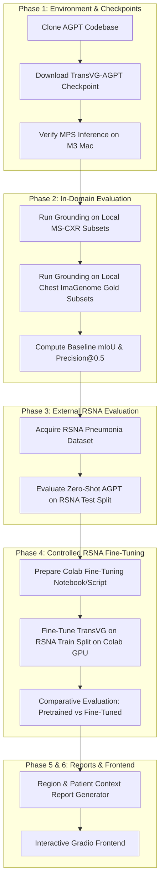

# InteractMed-VLM: Research Project Plan & Architecture Roadmap

**Lead ML Engineer:** Antigravity AI  
**Host Platform:** Apple Silicon MacBook Air M3 (16 GB Unified Memory) & Google Colab (Cloud GPU)  
**Project Repository:** `InteractMed-VLM`  
**Date:** October 10, 2026  

---

## 1. Project Overview & Research Objectives

**InteractMed-VLM** is an interactive, multimodal vision-language system for thoracic radiology. It combines medical phrase grounding, external clinical domain validation, region-guided report generation, and patient-context conditioning into a single workflow.

### Core Scientific Pillars:
1. **Medical Phrase Grounding:**
   - Integrate pretrained **TransVG-AGPT** weights (Anatomical Grounding Pre-Training, pre-trained on Chest ImaGenome and fine-tuned on MS-CXR) to map radiological descriptions to bounding boxes.
2. **External Validation on RSNA Pneumonia:**
   - Benchmark grounding generalization against the external RSNA Pneumonia Detection Challenge benchmark without in-domain fine-tuning.
3. **Controlled Adaptation (RSNA Fine-Tuning Ablation):**
   - Fine-tune TransVG-AGPT on the RSNA training split.
   - Conduct a controlled comparative evaluation: **Zero-shot Pretrained AGPT vs. RSNA Fine-Tuned AGPT** across Precision@IoU, mean IoU, and false positive rates.
4. **Region-Specific Report Generation:**
   - Generate clinical findings conditioned on localized visual features extracted from user-selected anatomical regions (Heart, Lungs, Pleural space).
5. **Patient-Context Conditioning:**
   - Condition study-level report generation on patient demographic metadata (`age_decile`, `gender`, clinical priors) to reduce generic report hallucination.
6. **Clinical-Grade Interactive Frontend:**
   - Provide an interface for clinicians and patients: upload CXR, query findings, visualize predicted bounding boxes and Grad-CAM overlays, and generate clinical findings paired with patient-friendly translations and independent urgency triage.

---

## 2. Hardware Allocation: Mac Terminal vs. Google Colab

The local machine is a **MacBook Air M3 with 16 GB Unified Memory**. To maximize efficiency and prevent memory exhaustion, we enforce a strict separation of computational responsibilities:

```
+-----------------------------------------------------------------------------------+
|                              SYSTEM DIVISION OF LABOR                             |
+-----------------------------------------------------------------------------------+
|  MacBook Air M3 (16 GB Unified Memory)        |  Google Colab (NVIDIA T4 / A100 GPU)|
|  Execution: Local Mac Terminal                |  Execution: Colab Cloud Terminal    |
+-----------------------------------------------+-----------------------------------+
|  - Dataset discovery, auditing & filtering    |  - TransVG-AGPT fine-tuning on    |
|  - Unified manifest & split creation          |    large RSNA training splits     |
|  - TransVG-AGPT single-image MPS inference    |  - Multi-epoch backpropagation    |
|  - Local offline evaluation (MS-CXR / Gold)   |  - Full-resolution grid search    |
|  - Interactive Web / Gradio frontend UI       |  - High-throughput batch inference|
|  - Unit testing & continuous integration      |  - Heavy vision-language training |
+-----------------------------------------------------------------------------------+
```

---

## 3. Current State Classification

To maintain scientific rigor, we classify all aspects of the project into four explicit categories:

### A. Implemented Features (Verified in Code)
* **Dataset Manifest Builder (`src/preprocessing/build_manifest.py`):** Parses MS-CXR and Chest ImaGenome Gold annotations, normalizes coordinate representations, and produces a unified manifest.
* **Dataset Inventory Script (`scripts/inventory_datasets.py`):** Automatically audits file integrity, cataloging 1,174 local images, record counts, and cross-dataset intersections without exposing PHI.
* **Vision Encoder Stub (`src/vision_encoder/encoder.py`):** Modular PyTorch module with standard CNN/ViT interfaces and MPS compatibility.
* **Anatomical Prior Grounding Stub (`src/region_grounding/grounding.py`):** Geometric prior bounding box generator and spatial feature pooling.
* **Urgency Triage Classifier (`src/triage/classifier.py`):** Rule- and keyword-based triage classifier strictly isolated from report generation.
* **Visual Explainer (`src/explainability/explainer.py`):** Bounding box rendering and Grad-CAM overlay compositor.
* **Test Suite (`tests/`):** 22 unit tests passing under `pytest` with PyTorch 2.2.2 on macOS.

### B. Successfully Executed Experiments
* **Local Data Inventory Audit:** Confirmed 1,174 valid local MIMIC `.jpg` images, 1,056 locally matched MS-CXR records (72.9%), 10,840 locally matched Chest ImaGenome Gold records (41.7%), and 13,992 matched unified manifest records (81.7%).
* **MPS Hardware Acceleration Verification:** Verified PyTorch 2.2.2 detects Apple Metal Performance Shaders (`torch.backends.mps.is_available() == True`).
* **Phase 1 Model Verification:** Successfully downloaded `transvg.pth` (2.0 GB), loaded all 523 weight tensors (0 missing / 0 unexpected keys), and executed forward inference on both CPU (0.28s/image) and Apple MPS (0.13s/image post-warmup) across all benchmark demo cases.

### C. Proposed Future Work
* **AGPT Modular Wrapper (`src/region_grounding/transvg_agpt.py`):** Wrap the verified TransVG model into our modular pipeline to formally replace the anatomical prior stub.
* **RSNA Benchmark Ingestion:** Download and format the RSNA Pneumonia Detection dataset into the unified bounding box schema.
* **Controlled Evaluation Pipeline:** Implement automated Precision@IoU ($IoU \in \{0.3, 0.5, 0.7\}$) metrics.
* **Fine-Tuning Script for Colab:** Deliver an end-to-end PyTorch script for RSNA fine-tuning.
* **Context-Conditioned Report Generator:** Implement prefix conditioning using patient demographics (`gender`, `age_decile`).
* **Interactive Web Application:** Complete the interactive UI with image upload, phrase grounding, and report generation.

### D. Unverified Assumptions (Now Tested & Clarified)
* *Assumption 1:* "All 1,541 images referenced by the manifest are present locally."  
  **Status: DISPROVEN.** Only 1,174 images (76.2%) exist locally. 367 images are missing.
* *Assumption 2:* "RSNA Pneumonia dataset is already on disk."  
  **Status: DISPROVEN.** RSNA is not present locally and must be downloaded.
* *Assumption 3:* "Pretrained TransVG-AGPT checkpoint exists locally."  
  **Status: RESOLVED & VERIFIED.** Downloaded from official Google Drive (`1INXf6rhAizBKf4IfC_Zi-pmyIbcdHKW9`) to `checkpoints/transvg.pth` and verified.

---

## 4. Phased Implementation Roadmap



---

## 5. Exact Terminal Commands by Execution Environment

### Phase 1: Checkpoint & Code Acquisition

#### [Mac Terminal] Step 1.1: Clone the Official AGPT Repository
```zsh
# Run in Mac Terminal inside project root
cd /Users/adityakachhot/interactmed
mkdir -p external checkpoints data/rsna
git clone https://github.com/Claire1217/AGPT.git external/AGPT
```

#### [Mac Terminal] Step 1.2: Download TransVG-AGPT Pretrained Weights
*Source:* Google Drive Folder `1lFaqAlG6AJExCjkW3Pbb24CX-LWSstrK`  
*Target:* `/Users/adityakachhot/interactmed/checkpoints/transvg.pth`

Using `gdown` in the local `dl` Python environment:
```zsh
# Run in Mac Terminal
/Users/adityakachhot/miniforge3/envs/dl/bin/python -m pip install gdown
/Users/adityakachhot/miniforge3/envs/dl/bin/gdown --folder "https://drive.google.com/drive/folders/1lFaqAlG6AJExCjkW3Pbb24CX-LWSstrK" -O checkpoints/
```

---

### Phase 2: Local Baseline Phrase Grounding Evaluation

#### [Mac Terminal] Step 2.1: Run Baseline Inference on Local MS-CXR Images
```zsh
# Run in Mac Terminal
/Users/adityakachhot/miniforge3/envs/dl/bin/python scripts/evaluate_grounding.py \
    --config configs/data_paths.yaml \
    --checkpoint checkpoints/transvg.pth \
    --benchmark ms_cxr \
    --device mps \
    --output docs/ms_cxr_baseline_results.json
```

---

### Phase 3: RSNA External Dataset Acquisition

#### [Mac Terminal] Step 3.1: Download RSNA Pneumonia Detection Challenge
```zsh
# Run in Mac Terminal (Requires Kaggle API credentials at ~/.kaggle/kaggle.json)
cd /Users/adityakachhot/interactmed/data/rsna
kaggle competitions download -c rsna-pneumonia-detection-challenge
unzip -q rsna-pneumonia-detection-challenge.zip
cd /Users/adityakachhot/interactmed
```

---

### Phase 4: Controlled RSNA Fine-Tuning (Google Colab)

Because training TransVG (ResNet-101 / ViT backbone + multi-modal transformer) requires continuous GPU backpropagation that exceeds the comfortable power budget of a fanless MacBook Air M3, training runs on Google Colab.

#### [Google Colab] Step 4.1: Colab Setup & Dependencies
```bash
# Run in Google Colab Notebook Cell (select Runtime -> Change runtime type -> GPU: T4 or A100)
!nvidia-smi
!git clone https://github.com/adityakachhot/InteractMed-VLM.git
%cd InteractMed-VLM
!pip install -q torch torchvision timm transformers pydicom albumentations gdown
```

#### [Google Colab] Step 4.2: Execute Fine-Tuning on RSNA Training Split
```bash
# Run in Google Colab Terminal or Notebook
!python scripts/train_rsna_transvg.py \
    --data_dir /content/rsna \
    --pretrained_checkpoint checkpoints/transvg.pth \
    --epochs 10 \
    --batch_size 16 \
    --lr 1e-4 \
    --output_dir /content/checkpoints_rsna_finetuned
```

#### [Google Colab / Mac Terminal] Step 4.3: Comparative Evaluation
```bash
# Run in Google Colab or Mac Terminal with downloaded fine-tuned weights
python scripts/compare_checkpoints.py \
    --base_checkpoint checkpoints/transvg.pth \
    --finetuned_checkpoint checkpoints/transvg_rsna_finetuned.pth \
    --test_labels data/rsna/stage_2_test_split.csv \
    --output docs/rsna_comparison_report.json
```

---

### Phase 5 & 6: Interactive Frontend & Pipeline Launch

#### [Mac Terminal] Step 6.1: Run the Interactive Web Application
```zsh
# Run in Mac Terminal
/Users/adityakachhot/miniforge3/envs/dl/bin/python src/interface/app.py \
    --config configs/model_config.yaml \
    --port 7860
```

---

## 6. Immediate Next Steps & Recommended Actions

1. **Acknowledge Data Inventory:** Confirm that 1,174 local MIMIC images are sufficient to begin Phase 1 and Phase 2 without redownloading the remaining 367 missing MIMIC images.
2. **Download TransVG-AGPT Checkpoint:** Download `transvg.pth` from Google Drive into `checkpoints/`.
3. **Download RSNA Challenge Dataset:** Ingest `stage_2_train_labels.csv` to enable the external evaluation pipeline.
4. **Build the TransVG-AGPT Wrapper Module:** Wrap the AGPT model architecture into `src/region_grounding/transvg_agpt.py` to replace the anatomical prior stub.
