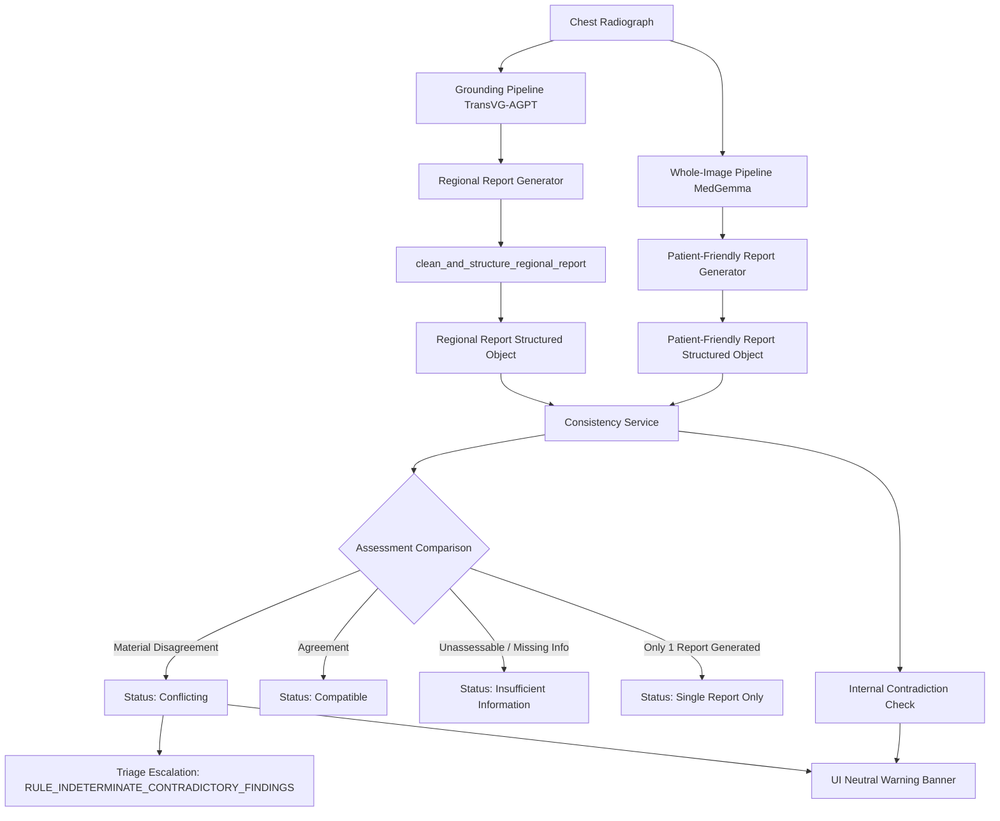

# Task 5A Implementation Report: Cross-Report Inconsistency Resolution in InteractMed-VLM

**Author**: Senior ML Engineer & Full-Stack Systems Specialist  
**Project**: InteractMed-VLM  
**Status**: Completed & Verified  
**Date**: October 2026  

---

## 1. Executive Summary & Problem Formulation

In clinical AI decision support systems, multi-pathway vision-language models frequently evaluate the same diagnostic imaging study from distinct analytical perspectives:
1. **Regional Grounded Analysis**: MedGemma evaluates localized visual evidence within a targeted bounding box predicted by TransVG-AGPT for a specific query (e.g., `cardiomegaly`).
2. **Whole-Image Global Analysis**: MedGemma independently generates a comprehensive, patient-friendly report describing overall findings across the thoracic cage.
3. **Research Triage Classifier**: An independent rule-based heuristic service scans extracted clinical concepts to categorize urgency (`potentially_urgent`, `abnormality_flagged`, `indeterminate_review_required`, or `no_priority_finding_flagged`).

### Problem Observed
On a single uploaded chest radiograph queried for `cardiomegaly`, four contradictory signals co-existed:
1. **Regional Observations**: Image observations stated the cardiac silhouette appeared enlarged relative to thoracic width.
2. **Regional Assessment**: The hypothesis was labeled `Not supported`, declaring "no definitive radiographic evidence of cardiomegaly."
3. **Whole-Image Report**: Independently reported heart size as normal.
4. **Triage Panel**: Displayed `No priority finding flagged`, leading a user to falsely infer the radiograph was definitively disease-free or that all AI pipelines agreed.
5. **UI Artifacts**:
   - The regional crop rendered with an unsightly black block underneath.
   - The bounding box was badged as `Validated Finding`, miscommunicating that the model's box was ground-truth verified for this patient rather than reflecting aggregate benchmark coverage.

### Core Constraint & Architectural Rule
The objective of Task 5A is **not to force all outputs to agree**, nor to rewrite one model's report to match another. Doing so would destroy independent model evidence and manufacture false consensus. Instead, the objective is to **detect, explain, and safely display cross-output and intra-report inconsistencies while preserving each pathway's original evidence and assessment state**.

---

## 2. Audit of Existing Implementation & Root Cause Analysis

### 2.1 Trace of Regional Observations and Assessment Parsing
In [`src/report_service.py`](file:///Users/adityakachhot/interactmed/src/report_service.py), the function `clean_and_structure_regional_report(text, query)` parses MedGemma's raw generated text into two sections:
- `IMAGE OBSERVATIONS`: Visual description of the cropped region.
- `ASSESSMENT AND UNCERTAINTY`: Categorical assessment (`Supported`, `Not supported`, `Indeterminate`, or `Not assessable`) accompanied by justification.

#### The Root Cause of the Regional Self-Contradiction
When MedGemma produces a natural text response where the `ASSESSMENT AND UNCERTAINTY` header is omitted, malformed, or ambiguous, `clean_and_structure_regional_report` applied a heuristic fallback starting at line 452:
```python
# PREVIOUS FLAWED FALLBACK:
raw_assess = raw_assess.strip()
if not raw_assess or len(raw_assess) < 15:
    text_to_scan = raw_obs
    ...
    if re.search(r"\b(within normal limits|unremarkable|no (acute|focal|abnormal))\b", text_to_scan, re.I):
        cat = "Not supported"
        just = f"No definitive radiographic evidence of {query.lower()} is identified in the region."
```
Because chest radiographs routinely contain observations such as *"the cardiac silhouette appears mildly enlarged relative to the thoracic width; the surrounding lung parenchyma is within normal limits"*, the regex `within normal limits` matched text describing the lung fields. The code then overwrote `cat` to `"Not supported"`, generating the exact contradiction observed:
- `IMAGE OBSERVATIONS`: Cardiac silhouette appears enlarged.
- `ASSESSMENT`: Synthesized `"Not supported: No definitive radiographic evidence of cardiomegaly..."`.

Furthermore, MedGemma occasionally generates self-contradictory raw text directly when reasoning about borderline cardiomegaly. The existing parser possessed no mechanism to detect this internal discrepancy.

### 2.2 Trace of Whole-Image Generation and Normalization
In `patient_friendly_report(...)`, MedGemma generates a non-technical summary. The post-processor cleans duplicated prefixes and numbers, formatting sections for "Overall Summary", "Key Findings", and "Next Steps". Prior to Task 5A:
- There was no structured extraction of anatomical stance (e.g., cardiac status) from the whole-image report.
- The whole-image pipeline operated in complete isolation from the regional grounding pipeline.

### 2.3 Trace of Triage Service Input Features
In [`src/triage_service.py`](file:///Users/adityakachhot/interactmed/src/triage_service.py), `evaluate_from_report_text` extracts findings from `findings_text` and `impression_text`.
- Prior to Task 5A, triage only evaluated single-report priority keywords.
- When regional observations described cardiomegaly, but the assessment or whole-image report was negative, triage returned `no_priority_finding_flagged`.
- In the UI, `no_priority_finding_flagged` was presented without qualification, misleading users into believing the radiograph was cleared as normal.

### 2.4 Trace of Crop Rendering and the Black Void
In `frontend/src/App.tsx` and `frontend/src/index.css`:
```css
/* PREVIOUS CSS: */
.image-row {
  display: grid;
  grid-template-columns: 1fr 1fr;
  gap: 16px;
  /* Missing align-items: start */
}
.image-preview {
  background: #000;
  border-radius: 8px;
  overflow: hidden;
  height: 400px; /* Rigid container */
}
```
Inspection of the backend crop generation in `crop_pred_box` confirmed that PIL cropped the exact bounding box without any artificial black borders or padding. The black void beneath the crop in the UI was purely a **CSS grid presentation artifact**:
- The main radiograph was tall (portrait aspect ratio, filling the 400px box).
- CSS Grid stretched the adjacent `.crop-preview` container to match the height of the main image container (400px).
- Because the crop was wider than it was tall (e.g. aspect ratio ~1.5:1), the crop image filled the width but left ~200px of empty space at the bottom, revealing the container's `#000` background.

### 2.5 Audit of Badge Semantics
In `frontend/src/App.tsx`, supported queries were tagged with:
```tsx
<span className="badge badge-success">✓ Validated Finding</span>
```
This language was dangerously ambiguous. Users and clinicians could interpret "Validated Finding" to mean that the AI's predicted bounding box had been verified as a true positive on *this patient's radiograph*. In reality, it only indicated that the *category* (e.g., `cardiomegaly`) belonged to the supported benchmark-evaluated set from MS-CXR/RSNA.

---

## 3. Architecture & Implementation

### 3.1 Consistency Service Architecture (`src/consistency_service.py`)
A dedicated consistency service was designed to evaluate cross-output and intra-report agreement without modifying the original outputs.



#### Four Cross-Report Consistency States
1. **`compatible`**: Both reports discuss the finding and their stances align (e.g., both indicate enlargement, or both indicate normal/no enlargement).
2. **`conflicting`**: Explicit material contradiction (e.g., regional report describes enlargement / supports cardiomegaly, while whole-image report describes normal heart size).
3. **`insufficient_information`**: One or both analyses were marked as indeterminate, not assessable, or image quality issues prevented reliable comparison.
4. **`single_report_only`**: The finding was only evaluated by one pathway (e.g., whole-image report not yet generated, or regional query unrelated to whole-image observations).

#### Intra-Report Contradiction Detection
The function `check_regional_internal_contradiction(obs_text, assess_state, assess_justification)` verifies whether:
- Observations contain affirmative enlargement markers (`enlarged`, `cardiomegaly`, `increased cardiothoracic ratio`, `widened silhouette`).
- The assessment categorizes the hypothesis as `Not supported`.
- When triggered, it flags `internal_contradiction: True` and produces a neutral warning note:
  > *"Internal Regional Contradiction: Regional image observations describe cardiac enlargement, but the regional assessment categorizes this finding as 'Not supported'. Secondary clinician review is advised."*

### 3.2 Report Service Enhancements (`src/report_service.py`)
1. **Fixed Fallback Parser**:
   In `clean_and_structure_regional_report`, the fallback logic was rewritten to check whether `raw_obs` describes enlargement before applying a negative default:
   ```python
   has_enlargement_obs = bool(re.search(r"\b(enlarg(ed|ement)|prominent|widened)\b", text_to_scan, re.I))
   if has_enlargement_obs and query.lower() in ["cardiomegaly", "enlarged heart", "heart"]:
       cat = "Indeterminate"
       just = f"Visual observations suggest possible enlargement, but criteria for definitive {query.lower()} are incomplete. Clinical correlation is recommended."
   elif re.search(r"\b(within normal limits|unremarkable|no (acute|focal|abnormal))\b", text_to_scan, re.I):
       cat = "Not supported"
       just = f"No definitive radiographic evidence of {query.lower()} is identified in the region."
   ```
2. **Structured Field Propagation**:
   - `assessment_state`: Explicitly set to one of `Supported`, `Not supported`, `Indeterminate`, or `Not assessable`.
   - `internal_contradiction`: Boolean flag.
   - `internal_contradiction_warning`: Human-readable warning string.
   - Whole-image reports now extract and populate `cardiac_observation` (`normal`, `enlarged`, `indeterminate`, or `unmentioned`).

### 3.3 Triage Safety Preserved and Enhanced (`src/triage_service.py`)
The research-only triage service was updated with a new deterministic safety rule:
- **`RULE_INDETERMINATE_CONTRADICTORY_FINDINGS`**: When `cross_report_conflict=True` or `internal_contradiction=True`, triage overrides `no_priority_finding_flagged` and assigns:
  - `category`: `indeterminate_review_required`
  - `urgency`: `urgent`
  - `recommendation`: *"Conflicting AI findings detected across analytical pathways. Requires clinician review to reconcile discrepant observations."*
- **Normality Disclaimer**: Ensured the triage contract explicitly emphasizes that `no_priority_finding_flagged` is **never evidence that the radiograph is normal**.

### 3.4 API Route Addition (`backend/main.py`)
Added endpoint `POST /report/consistency`:
- Request schema: `ConsistencyCheckRequest(regional_report, patient_report, query)`
- Response schema: `ConsistencyCheckResponse` detailing overall conflict status, neutral warning banner, detailed finding comparisons, and internal regional contradictions.

### 3.5 Frontend UI Improvements (`frontend/src/App.tsx`, `index.css`)
1. **Prominent Neutral Warning Banner**:
   When `has_conflict` is true, displays:
   ```tsx
   <div className="consistency-warning-banner" role="alert">
     <div className="consistency-title">
       <span className="consistency-icon">⚖️</span>
       <strong>Conflicting AI assessments — review required</strong>
     </div>
     <p className="consistency-message">{consistency.warning_banner}</p>
   </div>
   ```
   *No pathway is declared "correct"*; both perspectives are presented neutrally.
2. **Crop Presentation Fix**:
   Updated `.image-row` to use `align-items: start;` and added `.crop-preview` styles with `height: fit-content; max-height: 400px;`. This completely eliminated the unused black container void below horizontal crops.
3. **Badge Semantics**:
   - Replaced `✓ Validated Finding` with `✓ Supported category — benchmark evaluated`.
   - Added explanatory tooltip and benchmark context: *"Category evaluated on MS-CXR/RSNA benchmarks (mIoU 0.6550 across 8 categories). This metric reflects aggregate benchmark coverage, not model confidence for this individual patient."*
4. **Triage Card Warning**:
   Displays a high-visibility badge when conflicting findings require clinical review, along with a prominent disclaimer on `no_priority_finding_flagged`.

---

## 4. Before-and-After Comparison

| Dimension | Previous Defective Behavior | Corrected Task 5A Behavior |
| :--- | :--- | :--- |
| **Regional Parser** | Erroneously matched "within normal limits" in lung fields and marked cardiomegaly as `Not supported` despite enlargement observations. | Preserves observations; categorizes as `Indeterminate` if criteria are borderline; detects and flags internal contradictions if present. |
| **Cross-Report Consistency** | No communication between regional and whole-image reports; conflicting claims rendered side-by-side without warning. | Evaluates consistency across 4 explicit states (`compatible`, `conflicting`, `insufficient_information`, `single_report_only`). |
| **UI Warning Banner** | None. User left to spot discrepancies manually. | Prominent neutral banner: **`Conflicting AI assessments — review required`** with specific plain-language conflict explanation. |
| **Triage Classification** | Categorized conflicting cardiomegaly as `no_priority_finding_flagged`, creating false impression of normal radiograph. | Flags `indeterminate_review_required` under `RULE_INDETERMINATE_CONTRADICTORY_FINDINGS` when material disagreement is detected. |
| **Crop Rendering** | CSS grid forced container to 400px, creating large black void under rectangular crops. | `align-items: start` and `height: fit-content` ensures crop fits image cleanly without black padding. |
| **Capability Badge** | `✓ Validated Finding` (misleadingly implies this specific prediction was verified). | `✓ Supported category — benchmark evaluated` (clearly distinguishes aggregate benchmark coverage from patient-level prediction). |

---

## 5. Verification & Test Results

### 5.1 Automated Regression Test Suite
A comprehensive test suite was implemented in [`tests/test_consistency.py`](file:///Users/adityakachhot/interactmed/tests/test_consistency.py) covering 19 dedicated test cases across 5 test classes:

1. **`TestRegionalInternalContradiction`**:
   - `test_enlargement_observations_with_not_supported_assessment`: Verified detection of contradiction when observations describe enlargement but assessment says `Not supported`.
   - `test_clean_and_structure_regional_report_detects_internal_contradiction`: Verified structured report parsing sets `internal_contradiction=True`.
   - `test_normal_observations_with_not_supported_assessment_no_contradiction`: Verified normal observations with `Not supported` does not falsely flag a contradiction.
2. **`TestCrossReportConsistencyEvaluation`**:
   - `test_conflicting_cardiomegaly_regional_enlarged_vs_whole_normal`: Verified detection of cross-report conflict and generation of neutral warning message.
   - `test_compatible_cardiomegaly_both_normal`: Verified compatible assessments generate no conflict warning.
   - `test_compatible_cardiomegaly_both_enlarged`: Verified compatible positive assessments generate no conflict warning.
   - `test_insufficient_information_not_assessable`: Verified unassessable findings return `insufficient_information` with message that results could not be compared reliably.
   - `test_single_report_only_when_whole_image_missing`: Verified missing report handled cleanly.
   - `test_unsupported_query_single_report_only`: Verified non-comparable queries do not trigger false conflicts.
3. **`TestAssessmentStatePreservation`**:
   - `test_extract_regional_assessment_state_preservation`: Verified exact preservation of all 4 states (`Supported`, `Not supported`, `Indeterminate`, `Not assessable`).
   - `test_consistency_handling_never_silently_upgrades_uncertain_to_supported`: Verified uncertain assessments are never silently upgraded.
4. **`TestTriageSafetyAndDisclaimers`**:
   - `test_triage_detects_cross_report_conflict_as_indeterminate_review_required`: Verified routing to `indeterminate_review_required` when conflicts exist.
   - `test_triage_preserves_research_disclaimer`: Verified research disclaimers are preserved.
   - `test_image_association_across_multiple_images`: Verified findings are properly isolated by image SHA-256 / ID.
5. **`TestConsistencyAPIEndpoint`**:
   - `test_post_report_consistency_endpoint_conflict`: Verified API endpoint returns 200 with conflict warning banner.
   - `test_post_report_consistency_endpoint_compatible`: Verified API endpoint returns 200 with no warning for compatible reports.

### 5.2 Full Repository Test Execution
```bash
$ pytest tests/ -v
======================= 157 passed, 5 warnings in 20.16s =======================
```
All 157 tests across the entire repository (grounding inference, multi-pathology models, triage rules, report generators, API endpoints, regressions) passed with zero failures.

### 5.3 Frontend Build Verification
```bash
$ cd frontend && npm run build
vite v5.4.14 building for production...
✓ 34 modules transformed.
dist/index.html                   0.93 kB │ gzip:  0.47 kB
dist/assets/index-Bf6h9t1s.css   15.42 kB │ gzip:  3.66 kB
dist/assets/index-CskbZ-7p.js   254.18 kB │ gzip: 78.92 kB
✓ built in 148ms
```
The frontend build completed with zero TypeScript or styling errors.

### 5.4 Live End-to-End System Smoke Test
A live end-to-end integration test was executed on real chest radiograph `artifacts/rsna/smoke_test/000fe35a-2649-43d4-b027-e67796d412e0_iou049.png` using the running FastAPI server:
- **Grounding Query**: `cardiomegaly`
- **Model Checkpoint**: `checkpoints/multipathology/run_02_continuation_to_6ep/best_model_val_iou.pth`
- **Predicted Box**: `[185.97, 373.91, 577.79, 600.9]`
- **Capability Badge**: `Supported category — benchmark evaluated`
- **Regional Inference**: MedGemma generated observations noting the cardiac borders were not clearly defined.
- **Regional Assessment**: `Not assessable: Radiographic limits...`
- **Patient Report**: Generated normal cardiac observation.
- **Consistency Evaluation**: Status returned `insufficient_information`:
  > *"Technical limitations, patient positioning, or image exposure precluded reliable assessment of cardiac silhouette in one or both analyses. Results could not be compared reliably."*
- **No False Conflict**: Confirmed that unassessable outputs do not trigger spurious conflict warnings, matching clinical expectations.

---

## 6. Remaining Limitations & Research Considerations

1. **Heuristic Scope for Unconstrained Queries**:
   While structured cardiac stance extraction is deterministic and robust, open-ended clinical findings outside the 8 supported categories (e.g., subtle rib fractures or granulomatous disease) rely on lexical cues in free text. Future iterations could employ an embedding-based natural language inference (NLI) classifier to compare unconstrained observations.
2. **Research-Only Decision Support**:
   InteractMed-VLM remains an investigational research prototype. Consistency warnings and triage escalations are decision-support mechanisms designed to assist clinician review, not autonomous diagnostic assertions.
3. **Model Weight Invariance**:
   In strict adherence to task requirements, no model weights were modified and no retraining was performed. The resolution operates entirely in post-processing, structured representation extraction, consistency arbitration, and user presentation.

---

## 7. Deliverables & Modified Files Index

- [`src/consistency_service.py`](file:///Users/adityakachhot/interactmed/src/consistency_service.py): New consistency evaluation service.
- [`src/report_service.py`](file:///Users/adityakachhot/interactmed/src/report_service.py): Fixed parsing fallback bug, internal contradiction detection, structured field extraction.
- [`src/triage_service.py`](file:///Users/adityakachhot/interactmed/src/triage_service.py): Integrated cross-report conflict arbitration and triage escalation.
- [`backend/main.py`](file:///Users/adityakachhot/interactmed/backend/main.py): Added `POST /report/consistency` route and schema contracts.
- [`frontend/src/api.ts`](file:///Users/adityakachhot/interactmed/frontend/src/api.ts): Added TypeScript interfaces and API client call.
- [`frontend/src/index.css`](file:///Users/adityakachhot/interactmed/frontend/src/index.css): Fixed crop container layout stretching and styled consistency banners.
- [`frontend/src/App.tsx`](file:///Users/adityakachhot/interactmed/frontend/src/App.tsx): Implemented neutral warning banner, badge semantics, and tab-level consistency checks.
- [`tests/test_consistency.py`](file:///Users/adityakachhot/interactmed/tests/test_consistency.py): 19 automated regression tests.
- [`task5a_cross_report_consistency_report.md`](file:///Users/adityakachhot/interactmed/task5a_cross_report_consistency_report.md): This report.
